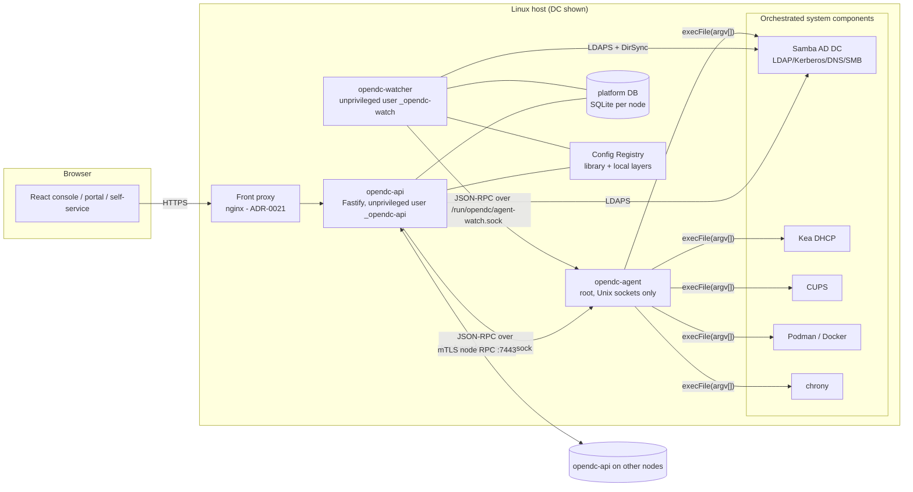
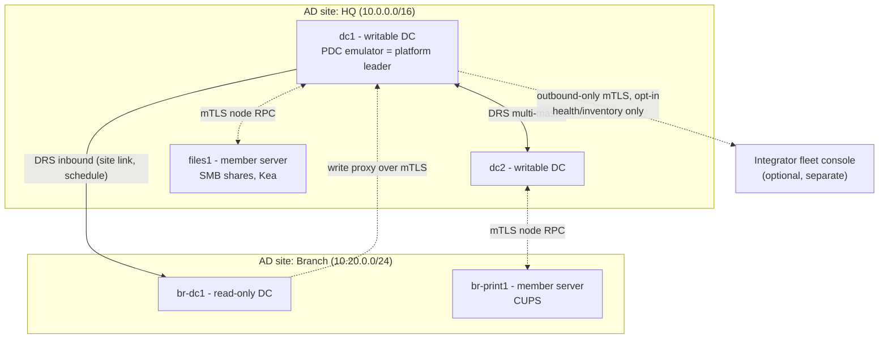
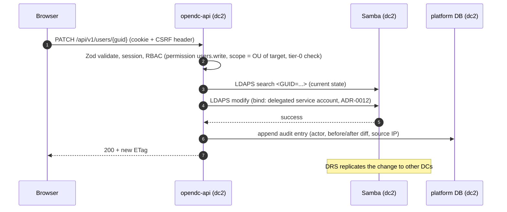
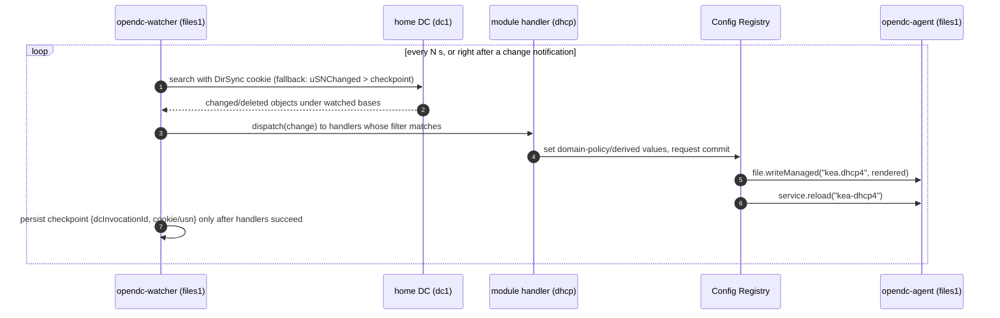
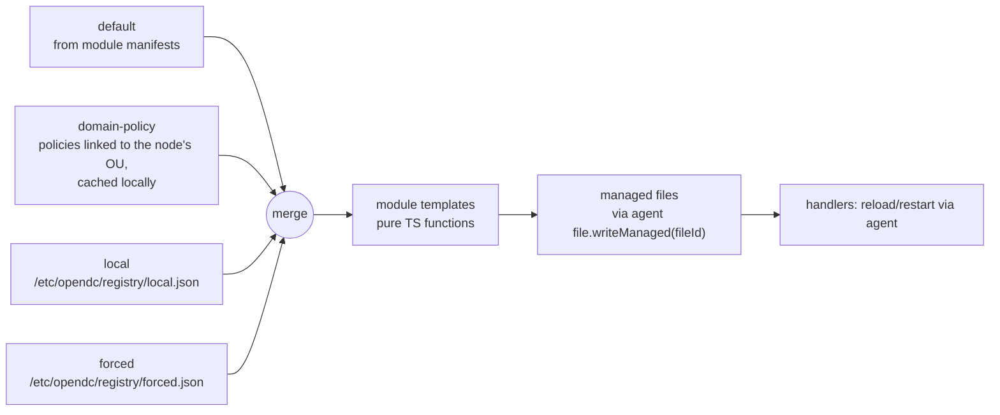

# OpenDC architecture

Status: **Phase 0 draft, awaiting review.** Decisions referenced as `ADR-NNNN` live in `docs/adr/`.

## 1. Summary

OpenDC turns a set of ordinary Linux hosts into a managed Active Directory domain with a web console, an
App Center, a portal and multi-server management. Each client organisation gets **one forest with one
domain**. The domain usually has several DCs across one or more sites, plus member servers and managed nodes.

Rules that run through the whole design:

| Principle | Consequence |
|---|---|
| Orchestrate, don't reimplement | Samba AD is the directory, KDC and (default) DNS. Kea does DHCP. CUPS does printing. Podman/Docker run apps. |
| One directory technology | Samba AD only. Platform objects live **in** the directory and replicate with it (ADR-0002, ADR-0003). |
| Every DC is equal for administration | Any writable DC serves the console and API. Only FSMO-bound operations need a specific DC. Domain-wide singleton jobs follow the PDC emulator (ADR-0017). |
| Least privilege | Unprivileged API and watcher processes; root only through the typed `opendc-agent` allowlist (ADR-0006). |
| Distro-agnostic core | All distro differences sit behind the OS adapter (ADR-0008). |
| Client autonomy | A client domain never depends on the integrator's fleet console. |

## 2. Node roles

| Role | Runs Samba as | OpenDC services | Serves console/API | Notes |
|---|---|---|---|---|
| Primary DC | AD DC (first in the domain) | api, agent, watcher | yes | "Primary" only means "provisioned first". After setup it's a DC like any other; FSMO roles can move. |
| Additional DC | AD DC (writable) | api, agent, watcher | yes | Full administration. Replicates via DRS. |
| Read-only DC | AD DC (RODC) | api (read-only mode), agent, watcher | read-only; writes are proxied to a writable DC | Samba RODC support is limited (§9). Holds no privileged platform credentials. |
| Member server | domain member (winbind) or none | api (node mode), agent, watcher | no (node RPC only) | Hosts shares, printers, Kea, apps. |
| Managed node | none (sssd/realmd or winbind) | agent, watcher, api (node mode) | no | Linux clients/servers under management (updates, registry, diagnostics). |

## 3. Components on a node



| Component | Process / user | Responsibility |
|---|---|---|
| `opendc-api` | `_opendc-api`, `NoNewPrivileges`, only `CAP_NET_BIND_SERVICE` if it binds <1024 | REST `/api/v1`, sessions, RBAC, audit, jobs (SSE), module routes, node RPC endpoint, scheduler (leader only). On member nodes it runs in **node mode**: node RPC only. |
| `opendc-agent` | root, socket-activated | Executes typed, schema-validated operations from a build-time allowlist. Separate sockets per caller with separate allowlists. No network listener. |
| `opendc-watcher` | `_opendc-watch` | Follows directory changes (USN/DirSync) and dispatches them to module handlers. Keeps a per-DC checkpoint. Triggers registry commits. |
| Config Registry | library used by api/watcher; local layers stored under `/etc/opendc/registry/` | Typed layered key/value store. Renders managed files from module templates; writes them through `agent:file.writeManaged`. |
| Platform DB | SQLite file per node (`/var/lib/opendc/platform.db`) | Sessions, jobs, audit log (replicated between writable DCs), watcher checkpoints, caches. **No secrets.** (ADR-0013) |
| Front proxy | distro nginx (proposed, ADR-0021) | TLS termination for console and app paths/hosts, HSTS. |
| `opendc` CLI | user's shell | Thin client of the same REST API (local Unix-socket or remote HTTPS + token). |

Secrets: root-owned files under `/etc/opendc/secrets/` (0600), managed by the agent. Services receive them via
systemd `LoadCredential=`, so they never sit in the platform DB or environment variables.

## 4. Domain topology



- **Sites and subnets** are first-class from Phase 4 (and modelled in the profile schema from Phase 2), so
  clients find their nearest DC and inter-site replication can be scheduled. Member nodes choose their
  "home DC" by site (DNS SRV `_ldap._tcp.<site>._sites.dc._msdcs.<domain>`), with failover.
- **Leader:** domain-wide singleton jobs (scheduled backups, update rollouts, CA root operations, audit
  retention, fleet heartbeat) run on whichever DC holds the **PDC emulator** role (ADR-0017). This reuses an
  existing AD singleton that admins already know how to transfer and seize, so we don't build our own
  consensus layer.

## 5. Request flow: an admin edits a user



Tier-0 operations (protected groups such as Domain Admins, FSMO, functional level, DC demotion) are not done
with the delegated account. They go to the agent on a writable DC, which runs them with local DC privileges
after an extra permission check and typed confirmation (ADR-0012).

## 6. Change propagation (the watcher)



Important properties (ADR-0004):
- `uSNChanged` is **per DC**. A checkpoint is bound to the DC's `invocationId`. If the watcher fails over to
  another DC, or the DC is restored from backup (new invocationId), it does a **full resync** (handlers are
  idempotent, so this is safe), then continues from the new DC's USN.
- Deletions come through DirSync, or through the Show Deleted control when polling.
- Handlers declare a base DN and LDAP filter, must be idempotent, and run with a timeout. A handler that keeps
  failing is quarantined: its checkpoint stops advancing, other handlers continue, and a diagnostic is raised.

## 7. Configuration model



Precedence: `default < domain-policy < local < forced`. Keys are typed (Zod) and declared by module
manifests. The domain-policy layer is computed from directory policies and cached on disk, so a node still
renders correctly when it can't reach a DC (ADR-0005).

## 8. Data placement

| Data | Lives in | Replication / scope |
|---|---|---|
| Users, groups, computers, OUs, GPO containers, DNS zones | Samba AD | DRS, domain-wide |
| Platform objects (policies, DHCP, shares, printers, app registrations, portal, RBAC roles, extended-attribute definitions, node registry) | AD, under `CN=OpenDC,CN=System,<domainDN>` (see `design/directory-object-model.md`) | DRS, domain-wide |
| SYSVOL (GPO files, logon scripts) | Filesystem on each DC | **Samba does not replicate SYSVOL.** OpenDC replicates it one way from the PDC emulator (ADR-0019). |
| Config Registry local/forced layers | `/etc/opendc/registry/` | Node-local |
| Sessions, jobs, watcher checkpoints, caches | Platform DB (SQLite) | Node-local |
| Audit log | Platform DB | Append-only, per-origin sequence numbers; pulled between writable DCs over mTLS so any DC can show full history (ADR-0013) |
| Secrets (service-account passwords, CA keys, app secrets) | `/etc/opendc/secrets/`, root 0600 | Node-local. Distributed only by agent-to-agent transfer over mTLS when a role needs it. |
| Certificates and CRLs (public parts) | AD (`CN=PKI,CN=OpenDC,...`) plus files | Domain-wide |

## 9. Known platform limitations that shape the design

These are facts about the components we orchestrate, not choices. Spec items affected by them are listed
in `docs/OPEN-QUESTIONS.md`.

1. **SYSVOL isn't replicated by Samba** (there's no DFS-R). We must do it (ADR-0019), including keeping
   `idmap.ldb` consistent across DCs so sysvol ACLs resolve the same way everywhere.
2. **Samba RODC is limited.** It can join and replicate, but some behaviour (for example forwarding certain
   writes, DNS updates, password replication policy edge cases) is incomplete. RODCs are supported for read
   and authentication in branch offices; the console on an RODC is read-only and proxies writes.
3. **Fine-grained password policies (PSOs) apply to users and groups, not OUs.** "Password policy linked to
   an OU" is implemented with an automatically maintained shadow group per policy (see §3 of the directory
   object model).
4. **Samba internal DNS** supports only global forwarders (no conditional forwarders) and accepts only
   GSS-TSIG for secure dynamic updates. Kea DDNS registration therefore needs GSS-TSIG support in Kea, or a
   OpenDC lease hook that registers through the agent. BIND9_DLZ is the option when conditional forwarding is
   needed.
5. **`samba-tool domain backup` restore** rebuilds a domain from one DC: the restored DC becomes the only DC
   and other DCs must be re-joined. Replacing one failed DC in a healthy multi-DC domain is a **re-join**, not
   a restore. The runbooks keep these two cases separate.
6. **AD schema changes are irreversible.** The MVP needs no schema extension (directory object model §5).
7. **Samba versions differ across distros** (and the container image pins its own). Features such as gMSA or
   functional level 2016 are capability-gated by the detected Samba version on every DC, not assumed.
8. **Samba AD DC built against MIT Kerberos** (Fedora, openSUSE) is still marked experimental upstream, and
   RHEL-family distros don't ship the DC role. They use container mode (ADR-0009).
9. A Samba DC can't join an existing Windows domain whose functional level is above what Samba supports
   (2016 at most, version-dependent). The migration pre-flight checks this.

## 10. Module system

Features are modules under `/modules/<id>/`. A module ships a **declarative** `manifest.ts`
(`docs/design/module-manifest.ts`) plus entry points for each target:

```
modules/dhcp/
  manifest.ts         declarative data only, no side effects
  api/index.ts        Fastify plugin (routes)
  web/*.tsx           lazy-loaded React routes
  registry/*.ts       key definitions + template functions
  watch/*.ts          watcher handlers
  diag/*.ts           diagnostic checks
  i18n/{en,de}.json
```

A build step (`npm run gen`) reads all manifests and generates per-target registries: the API module list,
web routes, the watcher handler table, the diagnostics table, the permission catalogue and the **agent
allowlist**. This keeps the agent from importing API/web code and makes the allowlist a build artefact rather
than runtime state (ADR-0022). Third-party UI extensions don't load into the console; they ship as apps with
their own UI and a portal tile.

## 11. Node-to-node communication

- Every node has a node certificate issued by the domain CA. Its SAN contains the FQDN and
  `URI:urn:opendc:node:<computer objectGUID>`, which binds the certificate to the machine account (ADR-0007).
- Node RPC is HTTPS with mutual TLS on port 7443 (configurable), served by `opendc-api`. It's a versioned
  JSON-RPC style API (`/node/v1/...`) with Zod schemas shared with the agent catalogue.
- Authorization: member nodes accept operation requests only from **writable DCs** (checked against the node
  registry and the cert's GUID). The originating DC has already checked the human's RBAC; the request carries
  the actor and a request id for audit on both sides.
- Revocation: CRL from the domain CA, plus a node `disabled` flag in the directory that's checked on every call.

## 12. PKI

Two tiers (ADR-0007):
- **Root CA**: created at domain provisioning on the first DC. Its key can be exported for offline storage
  and removed from the host afterwards (recommended for larger sites).
- **Issuing CA per writable DC**: each writable DC gets an intermediate certificate signed by the root, so any
  writable DC can issue and renew node and service certificates while the others are down. Each issuer
  publishes its own CRL.
- ACME (public names) uses an external client binary (ADR-0021).

## 13. Security boundaries (summary)

Details are in `docs/SECURITY.md`. The trust boundaries are browser↔proxy/API, API↔agent (Unix socket,
filesystem permissions, typed allowlist), node↔node (mTLS), platform↔Samba (LDAPS with verified certificate),
App Center catalog→host (Ed25519 signatures, pinned image digests), and client↔fleet console (outbound-only
mTLS, metadata only).

## 14. Packaging and runtime

- Packages `opendc-common`, `opendc-dc`, `opendc-member`, `opendc-node` (.deb/.rpm via nfpm, plus a tarball and
  install script). They **bundle a pinned Node.js runtime** under `/usr/lib/opendc/node`, so distro Node
  versions don't matter (ADR-0010, ADR-0016).
- systemd units: `opendc-api.service`, `opendc-watcher.service`, `opendc-agent.socket` + `opendc-agent.service`,
  and timers where needed. All hardened (SECURITY.md §6).
- Paths: `/usr/lib/opendc` (code), `/etc/opendc` (config, registry, secrets), `/var/lib/opendc` (DB, state,
  backups staging), `/run/opendc` (sockets), logs to journald.

## 15. Fleet console (Phase 7)

Separate deployable (`packages/fleet`, its own DB). Client installations connect **outbound** over mTLS
(opt-in, revocable by the client admin) and push health and inventory metadata only. The fleet console can
queue jobs (updates, diagnostics) that the client's leader DC pulls and runs after its own policy check. Write
access to a client directory is off by default and has to be granted explicitly per client. Deep links open
the client's own console; the fleet console never proxies directory data.
